# Classificar fotos de antes e depois

As 20 fotos da galeria "Resultados impressionantes" do site antigo foram baixadas, otimizadas e publicadas na home como "Caso 1" a "Caso 20". Em todas, a foto da esquerda é o **antes** e a da direita é o **depois**.

Preencha o campo **procedimento** de cada caso (por exemplo: ortognática, harmonização facial, cirurgia estética da face, implantes, ortodontia + ortognática). Se alguma foto não deve ser publicada, escreva **remover**. Confirme também que há autorização por escrito do paciente para cada imagem.

Depois de preenchido:

1. Na home (`index.html`), troque a legenda de cada caso (texto do `<figcaption>`, atributo `data-legenda` do botão e o `alt` da imagem) para incluir o procedimento. Exemplo de `alt`: "Antes e depois de cirurgia ortognática, vista de perfil".
2. Na LP (`cirurgia-ortognatica/index.html`), substitua os 3 pares de placeholder (procure `TROCAR PELAS FOTOS DE ORTOGNÁTICA`) pelos casos marcados como ortognática, copiando o bloco `<li class="galeria-item">` da home. Para a ampliação funcionar na LP, inclua também o bloco do lightbox antes da barra fixa: `<!-- bloco:lightbox --><!-- /bloco:lightbox -->` e rode `python3 scripts/sincronizar-blocos.py`.

Arquivos: `assets/img/resultados/resultado-NN-{480,768,1080}.{webp,avif}`. A coluna "vista" foi preenchida a partir da imagem; o procedimento precisa ser informado pelo Dr.

## Caso 1

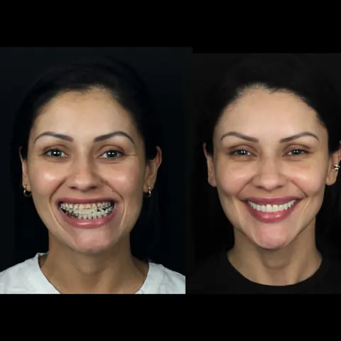

- arquivo: `assets/img/resultados/resultado-01` (original Wix: `fc0d26_12f5940113e84be9895b8a0be8d56a43~mv2.webp`)
- vista: frontal, sorrindo
- procedimento:

## Caso 2

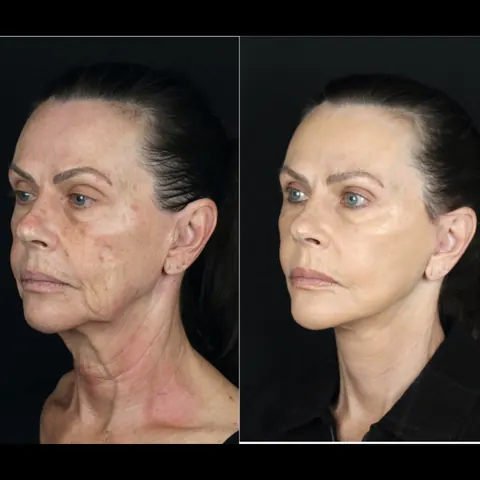

- arquivo: `assets/img/resultados/resultado-02` (original Wix: `fc0d26_05a57e374b6f4c69a725725ee6e5aa65~mv2.webp`)
- vista: três quartos
- procedimento:

## Caso 3

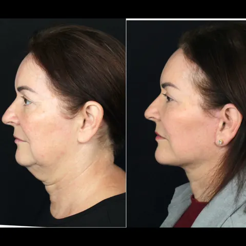

- arquivo: `assets/img/resultados/resultado-03` (original Wix: `fc0d26_7c2d90fa0c9940cea6f106de7972bc88~mv2.webp`)
- vista: perfil
- procedimento:

## Caso 4

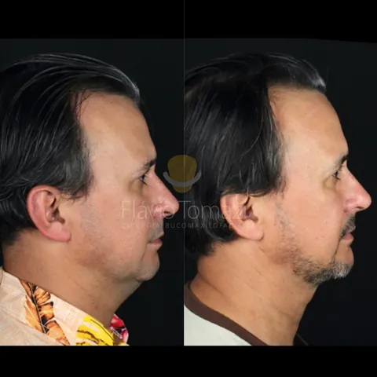

- arquivo: `assets/img/resultados/resultado-04` (original Wix: `b08f73_0c020cec55b846579315e82fdfa0df10~mv2.png`)
- vista: perfil
- procedimento:

## Caso 5

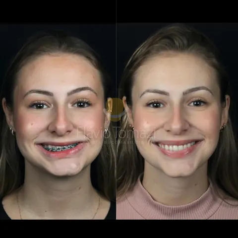

- arquivo: `assets/img/resultados/resultado-05` (original Wix: `b08f73_93f6f1464f2f438b897bd3a13463a242~mv2.png`)
- vista: frontal, sorrindo
- procedimento:

## Caso 6

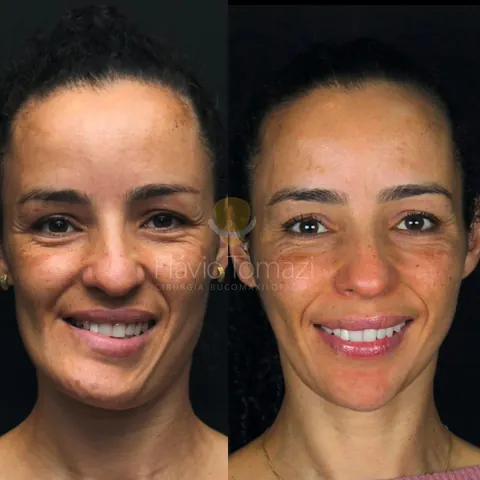

- arquivo: `assets/img/resultados/resultado-06` (original Wix: `b08f73_6d35148a7fd6440396ab445b1bab6356~mv2.png`)
- vista: frontal, sorrindo
- procedimento:

## Caso 7

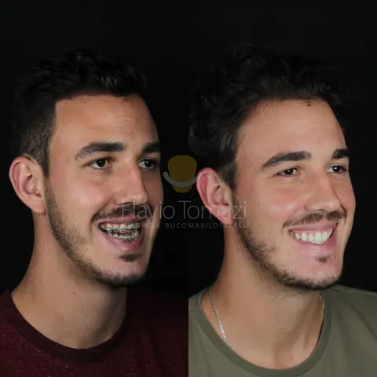

- arquivo: `assets/img/resultados/resultado-07` (original Wix: `b08f73_d4734520834b460e989cd2b6c2eed264~mv2.png`)
- vista: três quartos, sorrindo
- procedimento:

## Caso 8

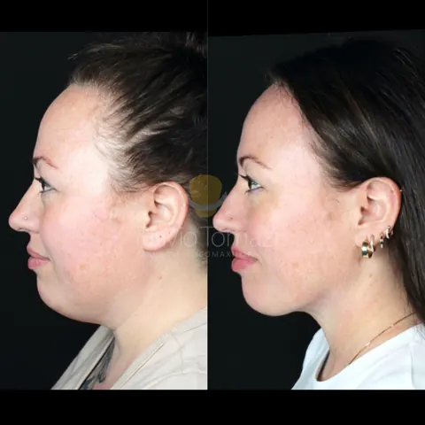

- arquivo: `assets/img/resultados/resultado-08` (original Wix: `b08f73_a16da8d786254b40ad21bf911ee748ce~mv2.png`)
- vista: perfil
- procedimento:

## Caso 9

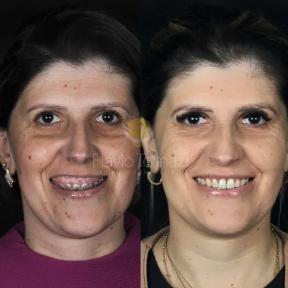

- arquivo: `assets/img/resultados/resultado-09` (original Wix: `b08f73_26bc0a27bd2f473f98ba2b68d557c0e7~mv2.png`)
- vista: frontal, sorrindo
- procedimento:

## Caso 10

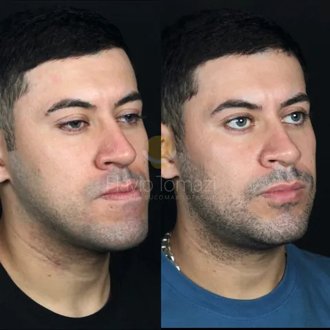

- arquivo: `assets/img/resultados/resultado-10` (original Wix: `b08f73_9914970f48ee4f819f4736a2667fa14d~mv2.png`)
- vista: três quartos
- procedimento:

## Caso 11

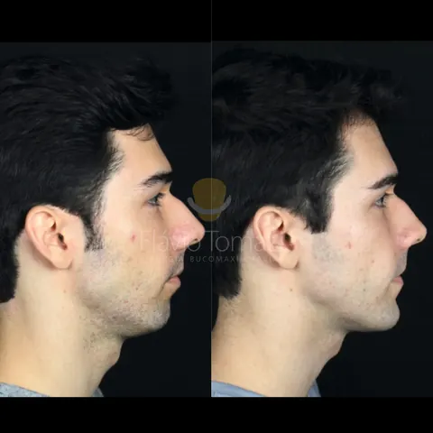

- arquivo: `assets/img/resultados/resultado-11` (original Wix: `b08f73_f64fe1fe3e894883a19cba4aa5a1449f~mv2.png`)
- vista: perfil
- procedimento:

## Caso 12

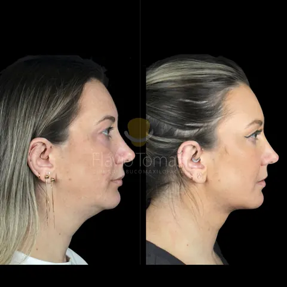

- arquivo: `assets/img/resultados/resultado-12` (original Wix: `b08f73_b8dc0c8fb1b14081a5027d9654333377~mv2.png`)
- vista: perfil
- procedimento:

## Caso 13

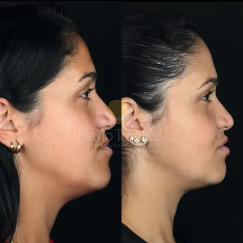

- arquivo: `assets/img/resultados/resultado-13` (original Wix: `b08f73_862524d487984fddab6675263b0a153f~mv2.png`)
- vista: perfil
- procedimento:

## Caso 14

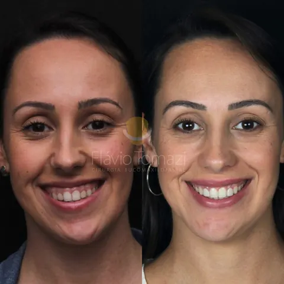

- arquivo: `assets/img/resultados/resultado-14` (original Wix: `b08f73_2e56bb8f59524a488e3353dcf3142bfc~mv2.png`)
- vista: frontal, sorrindo
- procedimento:

## Caso 15

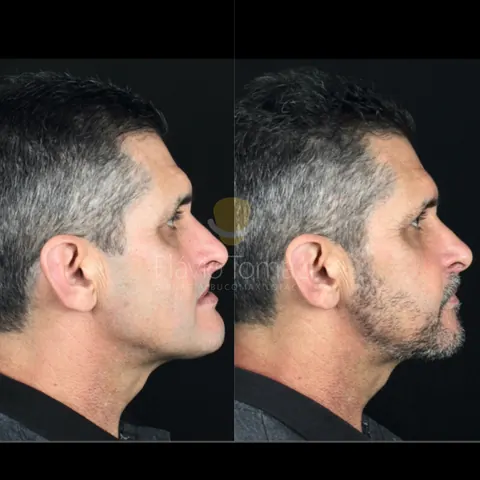

- arquivo: `assets/img/resultados/resultado-15` (original Wix: `b08f73_365b8c521deb4fcc9438662d788c8be8~mv2.png`)
- vista: perfil
- procedimento:

## Caso 16

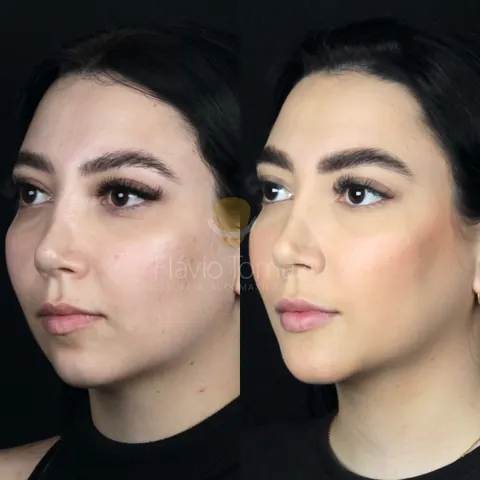

- arquivo: `assets/img/resultados/resultado-16` (original Wix: `b08f73_450cb29b18264f58b4bca57366b0e858~mv2.png`)
- vista: três quartos
- procedimento:

## Caso 17

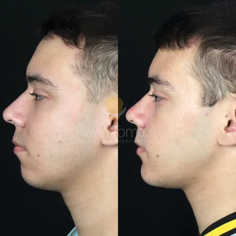

- arquivo: `assets/img/resultados/resultado-17` (original Wix: `b08f73_34ecb43f2deb475aab71f2e666c375a4~mv2.png`)
- vista: perfil
- procedimento:

## Caso 18

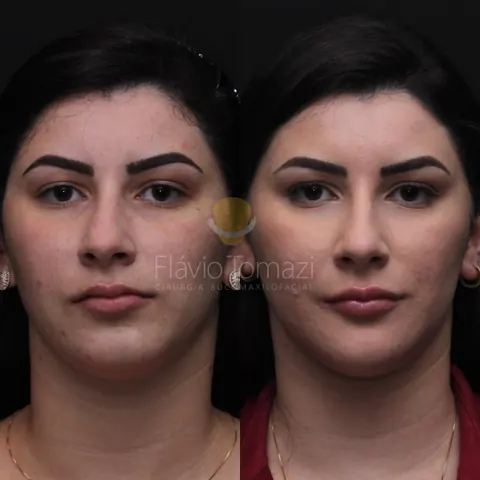

- arquivo: `assets/img/resultados/resultado-18` (original Wix: `b08f73_9c05ecd2a47246c9966452fdf66aa8b1~mv2.png`)
- vista: frontal
- procedimento:

## Caso 19

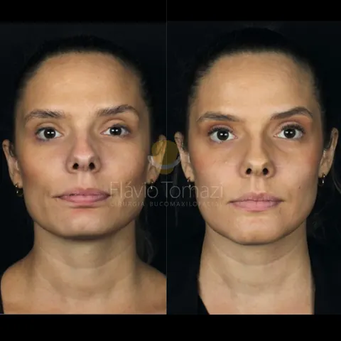

- arquivo: `assets/img/resultados/resultado-19` (original Wix: `b08f73_e1752902e4c1448f9f053a20105d8a4b~mv2.png`)
- vista: frontal
- procedimento:

## Caso 20

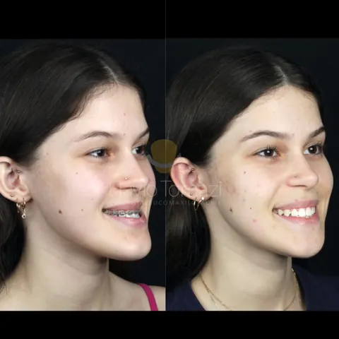

- arquivo: `assets/img/resultados/resultado-20` (original Wix: `b08f73_8c76a43786614bb79d65a6a365be0c7b~mv2.png`)
- vista: três quartos, sorrindo
- procedimento:
